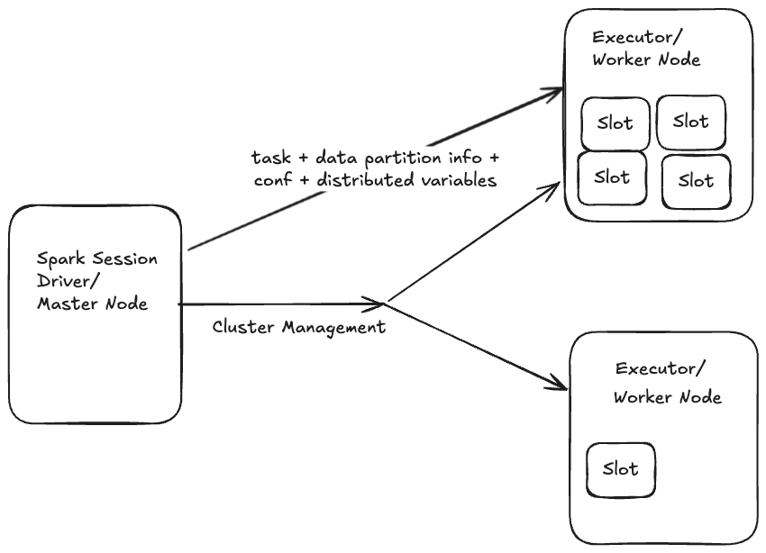
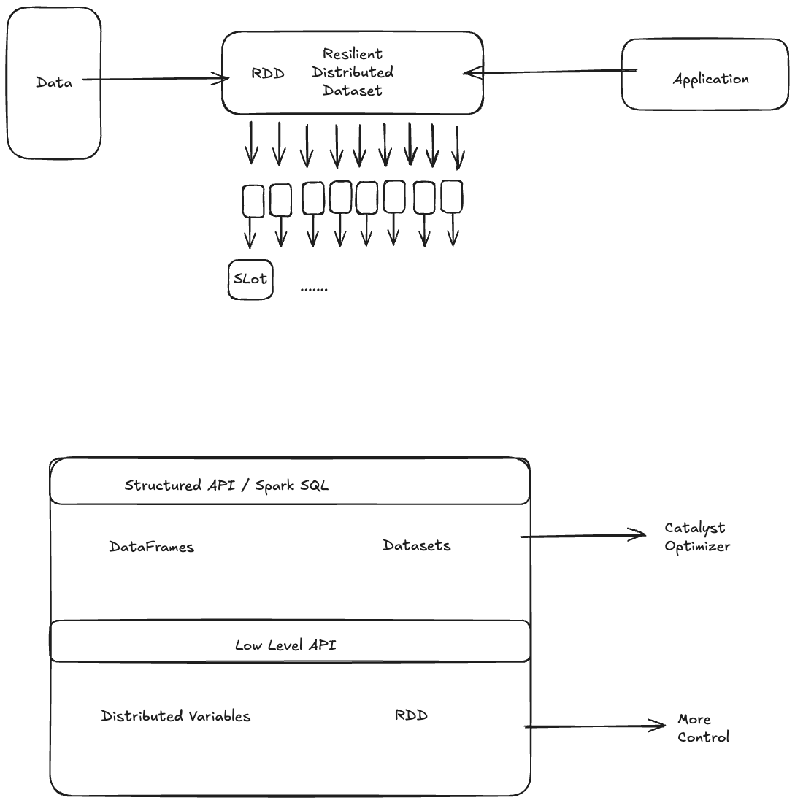
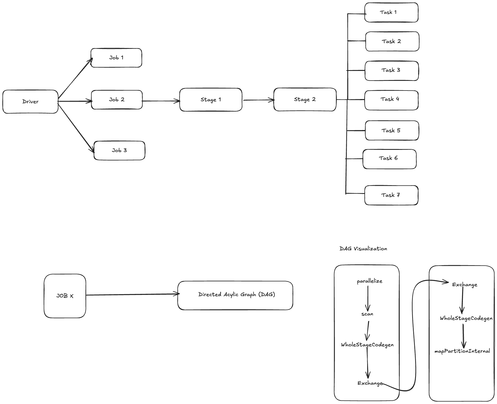
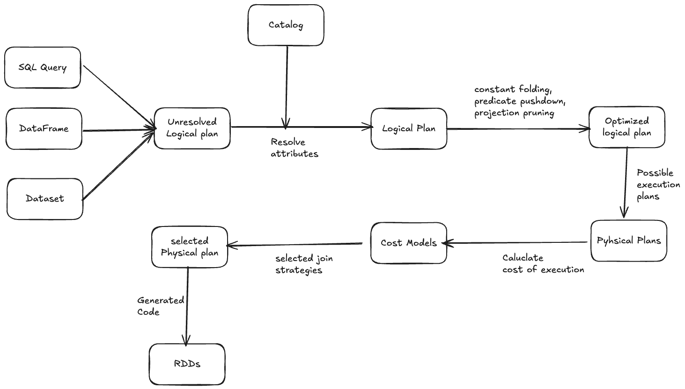

### Apache Spark

Apache spark is a unified computing engine and set of libraries for parallel data processing on computer clusters.

Apache Spark
- Spark SQL
- Streaming
- MLlib
- GrpahX
- Spark

It can be done at
- Databricks
- Google Cloud Dataproc
- IBM watson
- AWS EMR
- Azure

### RDDs, DataFrames and Datasets

#### RDD
RDD is the foundational data structure in Apache Spark, representing an immutable distributed collection of objects that can be processed in parallel. It provides fault tolerance, data lineage and supports a wide range of transformations and actions for large scale data processing.

#### DataFrames
Dataframes provide a higher level of abstraction over RDD, organzing data into named columns, similar to tables in relational databases, They offer optimizations through Spark's Catalyst Optimizer for efficient distributed processing, including advanced query optimization and code generation.

#### Datasets
Datasets combine the benefits of RDDs and Dataframes, offering a strongly typed object oriented API with optimization capabilities of DataFrames.

## Transformations and Actions

| Transformatons | Actions |
|------| -------|
| Transformation can be understood as a business logic you want to apply to your data | Demand for results |
| It takes one or more RDD/DataFrame/Dataset and transform into new | Collect, count, save , take, show | 
| Transformations can be either narrow, either wide. Wide transformations require shuffling data between partitions. | Actions are the operations that kick off the computation | 
| Example of narrow: Filter,Select, Create new column, Cast   Example of wide: Goup by, Sort, Join | |
| Transformations are lazy | |

## Jobs, Stages and Tasks

### Laziness of Spark

Spark is inteligent enough to move transformations or actions in a way it gets more efficient. For example

Read -> Groupby -> Wide T. -> Filter -> Show

Spark changes it into

Read -> Filter -> Groupby -> Wide T. -> Show

### Why do we care about data shuffling?

- Shuffling is the process of redistributing data across partitions and typically involves data exchange between executor nodes
- Wide transformations require shuffling

Points to Remember
- Shuffling is the process of redistributing data across partitions and typically involves data exchange between executor nodes
- It requires saving data to the disk, sending it over network and reading data from the disk.
- Data shuffling can be very expensive.
- Sometimes it can be mitigated or avoided by even a code changes

## Optimization

- Use of parquet or delta, instead of CSVs
- Avoid expensive operations like sort
- Minimize volume of data
- Cache / persist dataframes
- Repartition / Coalesce
- Avoid UDFs
- Partition or index data
- Bucketing
- Optimize Cluster

Spark is already doing a lot for us
- Catalyst Optimizer handles logical and physical query plan optimizations
- Tungsten provides low level optimizations and code generation techniques to improve overall performance
- AQE dynamically adjusts query execution based on runtime conditions.

### Catalyst Optimizer

### Tungsten

- The goal of Porject Tungsten is to improve Spark execution by optimizing Spark Jobs for CPU and memory efficiency
- Catalyst Optimizer generate optimized execution plan.
- Tungsten is used to generate optimized code, using whole stage codegen and improve how the data are handled in the cluster
- Comparing to Catalyst, Tungsten optimizations are way closer to bare metal.

### Adaptive Query Execution (AQE)

Adaptive Query execution is query re optimzation that occurs duting query execution.
- Dynamically changes sort merge join into broadcast hash join
- Dynamically coalesces partitions
- Dynamically handles skew
- Dynamically detects and propagates empty relations

