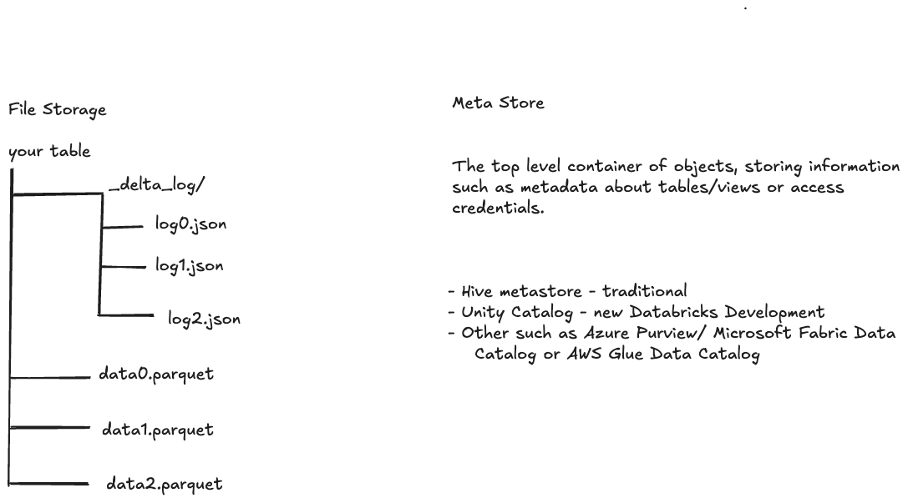

## Delta Lake

Why we want to use Delta Lake

Relational Databases
- Fast
- Easy to use
- ACID Compliant
- Structured Data

Big Data and Parquet Files
- Easily Scalable
- Cheaper
- Open Sourced
- NO ACID
- NOT EASY to use

Delta lake is optimized storage layer that provides the foundation for tables in a lakehouse on Databricks.
Delta Lake is open soource software that extends Parquet data files with a file based transaction log for ACID transactions and scalable metadata handling.

It gives us ACID and
- schema enforcement and evolution
- Time travel (Data Versioning)
- Data Compaction
- Unified Batch and streaming workloads
- Efficient upserts and deletes (MERGE)
- Scalability and Performance
- Data Reliability with Checkpoints
- Compliance and Auditing

